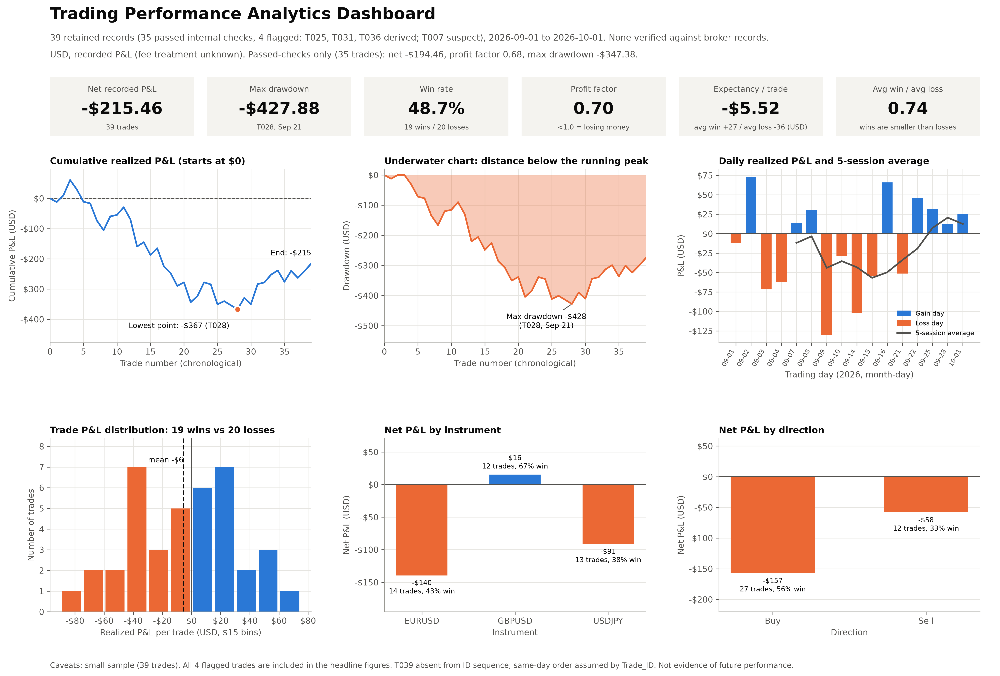

# Trading Performance Analytics Dashboard

**A reproducible Pandas + NumPy + Matplotlib portfolio capstone** analyzing a **synthetic** forex trading journal. This repository is a learning project—not live broker performance, a verified financial record, or investment advice.



## Project overview

The notebook loads 40 source rows, removes one exact duplicate (T011), standardizes labels, checks data quality, reconstructs three missing fields with explicit flags, reconciles estimated trade P&L against recorded P&L, calculates performance statistics, analyzes drawdown and time-based results, and exports a six-panel dashboard and audit reports.

The sample covers **September 1–October 1, 2026**, with 38 trades in September and one in October.

### Results on the supplied synthetic dataset

| Measure | Full retained journal | Records passing internal checks |
| --- | ---: | ---: |
| Number of records | 39 | 35 |
| Net recorded P&L | **−$215.46** | **−$194.46** |
| Win rate | 48.72% | 48.57% |
| Profit factor | 0.70 | 0.68 |
| Maximum dollar drawdown* | $427.88 | $347.38 |

*Trade-level drawdown uses `Trade_Date`, then `Trade_ID` as a surrogate within-day execution order. No execution timestamps or account starting balance are available. This is **absolute P&L drawdown**, not percentage account-equity drawdown.*

**Important distinction:** Of the 39 retained records, 35 pass internal consistency checks. T025, T031 and T036 contain reconstructed values and T007 has a suspicious instrument label. *Passing internal checks is not independent broker verification.* Both the complete-journal result and unflagged-subset result are displayed to avoid selective reporting.

## Quick start

**Prerequisite:** Python 3.10+ (tested with Python 3.11 and Pandas 2.2 / NumPy 2.x / Matplotlib 3.10).

From the repository root:

```bash
python -m venv .venv
source .venv/bin/activate     # Windows PowerShell: .venv\Scripts\Activate.ps1
python -m pip install -r requirements.txt
jupyter lab
```

Open `notebooks/Trading_Performance_Dashboard.ipynb` and use **Kernel → Restart Kernel and Run All Cells**. The notebook accepts a working directory of either the project root or `notebooks/`; it finds `data/raw/trading_journal_raw_project1.csv` and creates its output directories automatically.

After running the notebook, verify the exports:

```bash
python tests/verify_outputs.py
```

To regenerate the reviewed report, keep `reports/analytical_report_reviewed.md` in the repository. The notebook validates expected metrics for the provided synthetic input before copying that report to `reports/analytical_report.md`. **If the input dataset changes, revise and revalidate the fixed-sample narrative.**

## Folder structure

```text
Trading_Performance_Analytics_Capstone/
├── README.md
├── requirements.txt
├── .gitignore
├── notebooks/
│   └── Trading_Performance_Dashboard.ipynb
├── data/
│   ├── raw/trading_journal_raw_project1.csv
│   └── processed/trading_journal_cleaned.csv
├── figures/
│   ├── trading_dashboard.png
│   └── trading_dashboard.pdf
├── reports/
│   ├── analytical_report_reviewed.md     # canonical editorially reviewed version
│   ├── analytical_report.md              # notebook-generated copy
│   ├── analytical_report.pdf             # formatted reading copy
│   ├── cleaning_log.csv
│   ├── data_quality_report.csv
│   └── data_quality_and_cleaning_log.md
├── docs/
│   └── technical_defense_reference.md
└── tests/
    └── verify_outputs.py
```

## Methods

1. **Inspect & audit** raw fields, missing values, duplicate IDs, impossible numerical values and unparseable dates.
2. **Clean** instrument spellings and trade direction without modifying the raw CSV; retain original labels in audit columns.
3. **Reconstruct missing fields** for T025 (exit price), T031 (lot size) and T036 (P&L) using the price-change model, preserving `Imputed` and `Quality_Status` flags.
4. **Reconcile** calculated versus recorded P&L, allowing a documented **$0.50 absolute tolerance** for this exercise, including USDJPY currency conversion approximation. A match does **not** confirm that a reconstructed execution occurred.
5. **Explore** results by trade side, position size and instrument, flagging T007 without changing its instrument label.
6. **Measure performance** with win rate, average winner/loser, expectancy, profit factor, cumulative P&L, and absolute drawdown using the explicitly assumed trade order.
7. **Compare sensitivity scenarios** for the complete journal, three reconstructed records excluded, suspicious T007 excluded, and all four flagged records excluded.
8. **Visualize & communicate** six dashboard panels, provide a reviewed report, and independently verify exported metrics.

## Assumptions and limitations

- **Synthetic data** are included for educational demonstration; not independently verified against a broker.
- **T007:** Suspected instrument mismatch. Its original label is retained. Reclassifying it without evidence could distort instrument comparisons.
- **T025/T031/T036:** Reconstructed values are estimates derived from other fields; algebraic reconciliation is circular, not external validation.
- **T039:** Missing from the identifier sequence; no unsupported extra trade is created.
- **USDJPY:** Price-change P&L first has JPY units, then is approximately converted to USD using the exit price. Broker conversion dates/rates, rounding, and charges may differ. The reconstruction equations used for missing fields in this specific file concern USD-quoted pairs and must not be applied unmodified to missing USDJPY records.
- **Trading costs:** No separate commission, swap or spread charges or fee-treatment confirmation exists. Findings are **recorded P&L**; do not automatically classify them as net or gross of all costs.
- **Market risk:** The dataset lacks an account balance, timestamps, stop-losses and complete trade context. No percentage drawdown or long-term strategy edge is established. Only 39 records across 16 trading dates are available, and most are in September.
- **Statistical inference:** The descriptive results and t-statistic should not be treated as formal evidence of a persistent negative edge; independence and sample-size assumptions are weak.

## Deliverables and learning outcomes

The notebook and exports demonstrate data cleaning, reproducible pandas analysis, NumPy metrics, Matplotlib plotting, financial-domain unit awareness, sensitivity analysis and written business interpretation. The technical-defense reference in `docs/` is **study material**, not proof that the student personally answered the remaining defense question. Final mastery assessment remains with the mentor.

**Source:** The bundled synthetic journal provided for this educational capstone. No external market data or broker statements were used.
